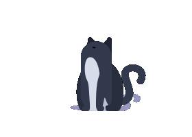

# Adarsh

AI and data science, shipped as products people actually use.

  

 

## Now building at edept

**[jobs.edept.co](https://jobs.edept.co)**: a placement platform for college students, from sign-up to offer.

- **Job board** fed by a daily pipeline on AWS that scrapes, cleans and AI-checks every listing before students see it
- **Resume and profile tools**: autofill from an uploaded resume, AI enhance, completeness guidance
- **Assessments** with auto-scored tests, plus events, drives and slot booking for colleges and employers
- **E-signed placement documents**: sealed PDFs, a tamper-evident ledger and a public verify page
- **Ritva**, an AI interviewer that runs live voice interviews and scores them

`Next.js` `TypeScript` `FastAPI` `PostgreSQL` `Supabase` `Claude` `AWS` `GSAP`

 

## Selected projects

<table>
<tr>
<td width="50%" valign="top">

**[RAG Course Assistant](https://github.com/ahadarshx/rag-course-assistant)** 
A citation-first study assistant for course material. Hybrid retrieval (FAISS, BM25, cross-encoder reranking), page-level citations and strict out-of-scope refusal, on a 4-bit Qwen2.5 1.5B that runs on consumer GPUs.

`RAG` `FAISS` `Qwen2.5` `Gradio`

</td>
<td width="50%" valign="top">

**[QLoRA Fine-Tuned LLM](https://github.com/ahadarshx/fine-tuning-llm)** 
Turning a small open model into a course-specific teaching assistant on limited VRAM: data prep, synthetic instruction sets, QLoRA training, evaluation and a chat app.

`QLoRA` `PEFT` `Transformers` `PyTorch`

</td>
</tr>
<tr>
<td width="50%" valign="top">

**[Series Analyzer](https://github.com/ahadarshx/series-analyzer)** 
An NLP suite for TV dialogue: scraping, zero-shot theme tagging, character networks, a custom classifier and an in-character chatbot, all in one Gradio app.

`spaCy` `NetworkX` `Scrapy` `Llama`

</td>
<td width="50%" valign="top">

**Vellune** · in development 
A local-first research library for students: search papers, read PDFs and cite in APA, IEEE, AMA and more. No accounts, native on Linux and Windows.

`Rust` `GTK4` `libadwaita`

</td>
</tr>
</table>

 

## Desktops

I like my tools to look as good as they work.

<table>
<tr>
<td width="50%" valign="top">

**[niri rice](https://github.com/ahadarshx/niri-rice)** 
niri on Fedora with DankMaterialShell. One wallpaper palette across every app, real blur, hourly wallpaper rotation.
</td>
<td width="50%" valign="top">

**[Catppuccin Tahoe](https://github.com/ahadarshx/catppuccin-tahoe)** 
A macOS Tahoe-style GNOME desktop in Catppuccin Mocha, with a glide dock and a music pill.
</td>
</tr>
</table>

 

## Toolbox

 

